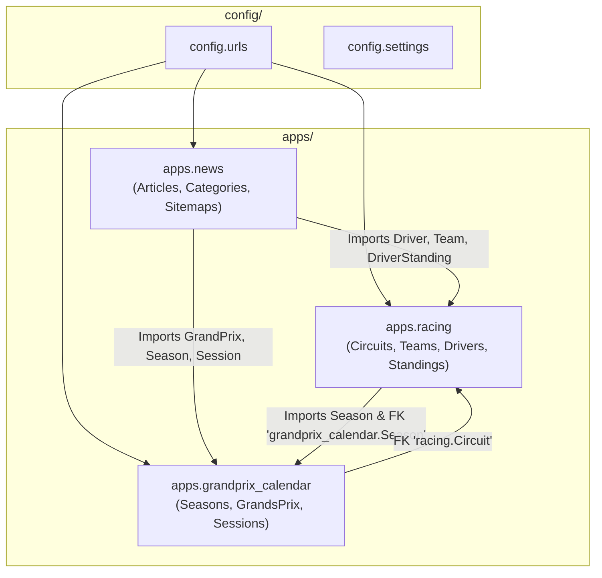
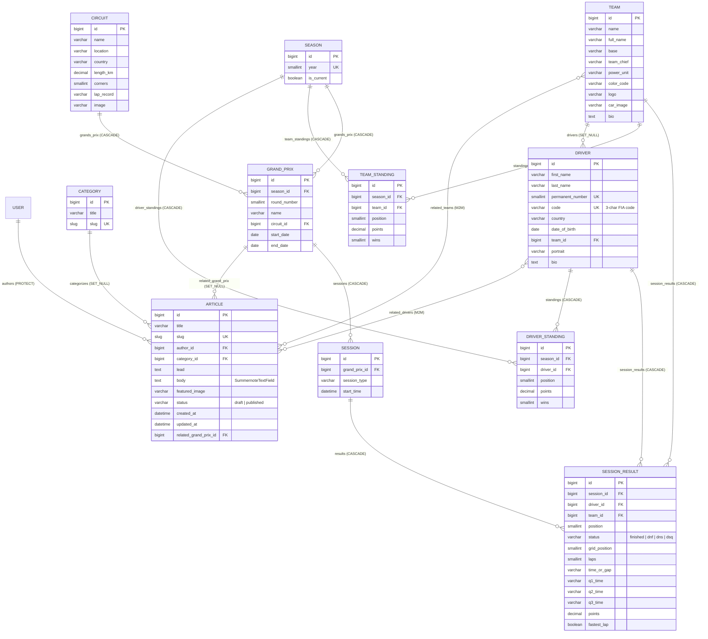
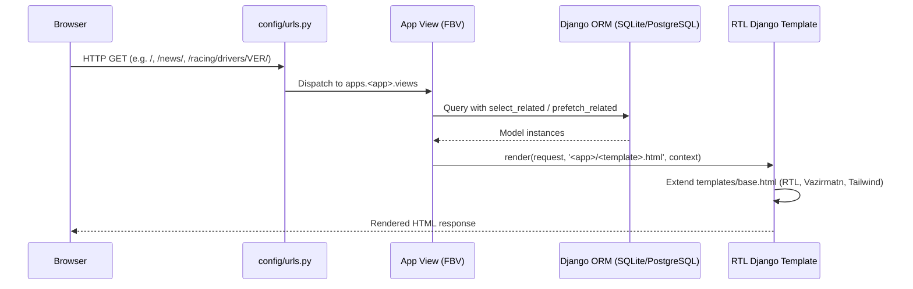

# System Architecture

**FormulaFarsi (PitStop News)** is a monolithic server-rendered Django 5.2 LTS web application providing Persian-language (RTL) Formula 1 news, race calendars, driver/team profiles, and championship standings.

---

## 1. Technology Stack

| Layer | Technology | Role |
| :--- | :--- | :--- |
| **Runtime & Packaging** | Python $\ge 3.13$, `uv` | Deterministic dependency management (`pyproject.toml` + `uv.lock`) and virtualenv execution |
| **Web Framework** | Django 5.2 LTS (`>5.2,<5.3`) | URL routing, ORM, server-side template rendering, admin panel, and sitemaps |
| **Environment Loader** | `django-environ` + `python-dotenv` | Strict, typed environment variable loading via `config/env.py` |
| **Rich-Text Editor** | `django-summernote` + `bleach` | Persian RTL WYSIWYG editor (`fa-IR`, Vazirmatn font) with HTML sanitization and media attachments |
| **Image Handling** | `Pillow` | Image validation and storage for circuits, driver portraits, team logos/cars, and article covers |
| **Database** | SQLite 3 (dev) / PostgreSQL (prod-ready) | Configured via `DATABASE_URL` in `config/settings.py` |
| **Frontend UI** | Django Templates + Tailwind CSS CDN + Vazirmatn | Responsive dark-themed (`zinc-950`) RTL layout (`dir="rtl"`, `lang="fa"`) | jdatetime
| **Dev & Testing Tooling** | `pytest`, `pytest-django`, `pytest-cov`, `pytest-xdist`, `factory-boy`, `faker`, `django-debug-toolbar`, `django-extensions`, `werkzeug` | Automated testing, parallel execution, SQL query profiling, and `runserver_plus` |

---

## 2. Repository & Package Layout

```text
formulafarsi-web/
├── .agent/skills/            # Shared Antigravity & Gemini skills for the team
├── apps/                     # Domain Django applications
│   ├── grandprix_calendar/   # Season, GrandPrix, Session (app_label: 'grandprix_calendar')
│   ├── news/                 # Category, Article, sitemaps (app_label: 'news')
│   └── racing/               # Circuit, Team, Driver, Standings (app_label: 'racing')
├── config/                   # Project configuration & entrypoints
│   ├── env.py                # Strict Env(environ.Env) subclass and load_env_files()
│   ├── settings.py           # Environment-driven Django settings
│   ├── urls.py               # Root URLconf, Summernote, sitemaps, and Debug Toolbar
│   ├── asgi.py               # ASGI entrypoint
│   └── wsgi.py               # WSGI entrypoint
├── docs/                     # Technical documentation (kept in sync with code)
│   ├── README.md             # Documentation index and maintenance rules
│   ├── architecture.md       # System architecture (this file)
│   ├── TODO.md               # Bug tracker and feature roadmap
│   └── modules/              # Per-app deep-dive documentation
├── env/                      # Environment configuration files
│   ├── .env.example          # Tracked template
│   └── .env                  # Local environment secrets (git-ignored)
├── media/                    # Uploaded media files (git-ignored)
├── templates/                # Server-rendered RTL HTML templates
│   ├── base.html             # Master layout, desktop nav, mobile drawer, footer
│   ├── grandprix_calendar/   # Calendar list and Grand Prix detail views
│   ├── news/                 # Home page, article archive, and article detail views
│   └── racing/               # Standings, driver list/detail, and team list/detail views
├── GEMINI.md                 # Project rules for Antigravity & Gemini
├── CONTRIBUTING.md           # Git commit and branch conventions
├── manage.py                 # Django management entrypoint
├── pyproject.toml            # Dependencies and pytest configuration
└── uv.lock                   # Locked dependency tree
```

### App Naming vs. App Labels
All domain apps live inside the `apps/` Python package:
- Python import path: `apps.news`, `apps.racing`, `apps.grandprix_calendar`
- `AppConfig.name`: `'apps.news'`, `'apps.racing'`, `'apps.grandprix_calendar'`
- `AppConfig.label` (automatic last segment): `'news'`, `'racing'`, `'grandprix_calendar'`

Because the short `label` is preserved, all database table names (`news_article`, `racing_driver`, `grandprix_calendar_session`), model string references (`'racing.Circuit'`, `'grandprix_calendar.Season'`), and URL namespaces (`news:...`, `racing:...`, `grandprix_calendar:...`) use the short app name.

---

## 3. Environment Configuration (`config/env.py`)

`config/settings.py` never reads `os.environ` directly or hardcodes secrets. Instead, it delegates to [`config/env.py`](../config/env.py):

1. **`load_env_files(ENV_DIR)`** loads environment files from `env/` using `python-dotenv` with the following precedence (highest to lowest):
   - Real OS process environment variables (`os.environ`)
   - Environment-specific file: `env/.env.<DJANGO_ENV>` (defaults to `env/.env.local` if present)
   - Base file: `env/.env`
2. **`Env(environ.Env)`** provides strict, typed readers:
   - `env.required("SECRET_KEY")`: Raises `ImproperlyConfigured` if missing or blank.
   - `env.str(var, default=...)`: Reads literal string values without expanding leading `$` characters.
   - `env.bool(var, default=...)`: Accepts only valid boolean strings (`true`/`false`, `1`/`0`, `yes`/`no`, `on`/`off`) and raises `ImproperlyConfigured` on typos.
   - `env.list(var, default=...)`: Strips whitespace around items and drops empty segments.
   - `env.db("DATABASE_URL", default=...)`: Parses database connection URLs into Django `DATABASES` dictionaries.

---

## 4. Application Dependency Map



- **`apps.news`** is the top-level editorial aggregator:
  - Its models link to `apps.racing.models.Driver`, `apps.racing.models.Team`, and `apps.grandprix_calendar.models.GrandPrix`.
  - Its home view aggregates the next upcoming `Session` (`apps.grandprix_calendar`) and the top 5 `DriverStanding` rows (`apps.racing`).
  - Its `sitemaps.py` generates sitemaps for `Article`, `Driver`, `Team`, and static views across all three apps.
- **`apps.racing`** and **`apps.grandprix_calendar`** share a mutual domain link:
  - `GrandPrix.circuit` points to `'racing.Circuit'` via a lazy string `ForeignKey` (preventing circular Python imports between `models.py` files).
  - `DriverStanding.season` and `TeamStanding.season` point to `'grandprix_calendar.Season'` via lazy string `ForeignKey`s.

---

## 5. Entity-Relationship (ER) Diagram



---

## 6. Request Lifecycle



1. **URL Routing (`config/urls.py`):**
   - `/admin/` $\rightarrow$ Django Admin (with `SummernoteModelAdmin` and inline-editable standings/sessions).
   - `/` and `/news/...` $\rightarrow$ `apps.news.urls` (`namespace='news'`).
   - `/calendar/...` $\rightarrow$ `apps.grandprix_calendar.urls` (`namespace='grandprix_calendar'`).
   - `/racing/...` $\rightarrow$ `apps.racing.urls` (`namespace='racing'`).
   - `/summernote/...` $\rightarrow$ `django_summernote.urls` (editor iframe and authenticated image/file uploads).
   - `/sitemap.xml` $\rightarrow$ `django.contrib.sitemaps.views.sitemap`.
   - `/__debug__/...` $\rightarrow$ `debug_toolbar.urls` (only when `DEBUG=True` and `django-debug-toolbar` is installed).
2. **Active Season Resolution Pattern:**
   Views in `apps.news`, `apps.racing`, and `apps.grandprix_calendar` resolve the active season using:
   ```python
   current_season = (
       Season.objects.filter(is_current=True).first()
       or Season.objects.order_by('-year').first()
   )
   ```
   This guarantees graceful fallback to the most recent season year if no season has `is_current=True`.
3. **ORM Query Optimization:**
   Every view preloads foreign keys (`select_related`) and reverse/many-to-many relations (`prefetch_related`) before rendering templates to prevent N+1 queries.
4. **Template Rendering (`templates/`):**
   All templates extend `templates/base.html`, which sets `<html lang="fa" dir="rtl">`, loads Tailwind CSS and the Vazirmatn font, and provides the sticky header, mobile drawer navigation, and footer.
